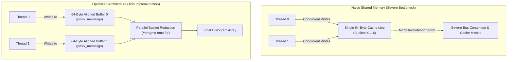

# Multiprocessor Parallel Computing & Cache Optimization in OpenMP

[](https://en.wikipedia.org/wiki/C99)
[](https://www.openmp.org/)
[](https://www.epfl.ch/)
[-blue.svg)](#hpc-cluster-execution-slurm)

High-performance shared-memory parallel implementations developed for **CS-307: Introduction to Multiprocessor Architecture** at **École Polytechnique Fédérale de Lausanne (EPFL)**.

This repository focuses on low-level multi-core systems optimization, addressing fundamental hardware bottlenecks in modern multi-core SMP and NUMA architectures:
1. **Cache Coherence & False/True Sharing Elimination**: Optimizing concurrent Monte Carlo histogramming via 64-byte cache-line alignment, padding, and thread-local state.
2. **2D Stencil Heat Transfer Simulation**: High-throughput parallel stencil computation over large 2D grids (up to $10{,}000 \times 10{,}000$ elements, 100M cells) utilizing static row partitioning, thread pool persistence, loop unrolling, and double-buffering.

---

## Key Technical Highlights

* **Cache Coherence & Invalidation Storm Prevention**: Mitigated false sharing under MESI/MOESI cache coherence protocols by guaranteeing 64-byte alignment (`posix_memalign`) and cache-line padding for thread-local write buffers.
* **Thread Overhead Amortization**: Hoisted `#pragma omp parallel` outside the iterative simulation loop, creating the thread pool once and eliminating per-iteration fork-join latency.
* **Spatial Data Locality & False-Sharing-Free Decomposition**: Decomposed 2D row-major matrices along the outer row dimension with static scheduling (`schedule(static)`), ensuring each thread accesses contiguous cache lines without overlapping with neighboring threads.
* **Instruction-Level Parallelism (ILP)**: 2-way manual inner-loop unrolling to maximize register reuse and pipeline throughput.
* **Zero-Copy Double Buffering**: Constant-time $O(1)$ pointer swapping between time steps using `#pragma omp single` with implicit barrier synchronization.
* **Thread-Safe Reentrant RNG**: Replaced shared pseudo-random number generator state with thread-local `erand48()` state seeds (`seed[2] = omp_get_thread_num()`).

---

## Architecture & Optimization Breakdown

### Part 1: Eliminating True & False Sharing (`sharing.c`)

In concurrent Monte Carlo histogram generation, multiple threads generate random numbers and increment corresponding bucket counters.



#### Problem Analysis
* **True Sharing**: When multiple threads update the exact same bucket counter simultaneously, requiring synchronization or atomic operations.
* **False Sharing**: When multiple threads update distinct bucket counters located within the same 64-byte L1/L2 cache block. Even though logical data is independent, the hardware cache coherence protocol (e.g. MESI) continuously marks the cache line as *Invalid* on other cores, creating high bus traffic and severe latency penalties.

#### Optimization Strategy
1. **Thread-Local Histograms**: Allocated dedicated private histograms per thread, completely eliminating cross-thread synchronization and true sharing during the sampling loop.
2. **Cache-Line Alignment & Rounding (`posix_memalign`)**:
   ```c
   size_t size = (num_buckets * sizeof(int));
   size += BLK_SIZE - (size % BLK_SIZE); // Round up to 64-byte multiple
   posix_memalign((void**)&tmp_hist[i], BLK_SIZE, size);
   ```
   Ensures that every thread's buffer starts at a 64-byte memory boundary and occupies discrete cache lines, completely eradicating false sharing.
3. **Reentrant Random Number Generation**: Each thread instantiates a dedicated `rand_gen` struct with independent seed state (`seed_array[2] = omp_get_thread_num()`), querying `erand48()` without lock contention.
4. **Parallel Merge Reduction**: Merges per-thread histogram arrays into the output histogram via OpenMP dynamic/static parallel reduction over bucket indices.

---

### Part 2: 2D Heat Transfer Stencil Simulation (`algorithm.c`, `heatmap.c`)

Simulates heat diffusion on a 2D square plate governed by an iterative 9-point finite-difference stencil:
$$T_{i,j}^{(t+1)} = \frac{1}{9} \sum_{k=-1}^{1} \sum_{l=-1}^{1} T_{i+k, j+l}^{(t)}$$

* **Boundary Conditions**: Edges are cold heat sinks held permanently at $0^\circ\text{C}$.
* **Heat Source**: A central core of 4 cells is maintained constantly at $1000^\circ\text{C}$.

```
 0°C (Heat Sink)
┌─────────────────────────────────┐
│ 0   0   0   0   0   0   0   0   │
│ 0   .   .   .   .   .   .   0   │
│ 0   .   . 1000 1000 .   .   0   │  <-- Central Heat Generator
│ 0   .   . 1000 1000 .   .   0   │
│ 0   .   .   .   .   .   .   0   │
│ 0   0   0   0   0   0   0   0   │
└─────────────────────────────────┘
 0°C (Heat Sink)
```

#### Optimization Techniques

1. **Persistent Thread Pool (Thread Reuse)**:
   * **Naive approach**: Spawning and joining OpenMP threads on each iteration (`#pragma omp parallel for` inside the time loop) causes significant runtime overhead.
   * **Optimized approach**: `#pragma omp parallel` wraps the entire outer loop across all $N$ iterations. Threads stay alive, synchronizing via lightweight `#pragma omp for` barriers between steps.

2. **Row-Major Memory Alignment & Static Scheduling**:
   * Storing matrices in 1D contiguous arrays (`input[i * length + j]`).
   * Parallelizing over rows ($i$ dimension) with `#pragma omp for schedule(static)` assigns contiguous blocks of rows to each core.
   * Threads access disjoint memory regions, maximizing spatial cache locality and avoiding false sharing at row boundaries.

3. **Loop Unrolling (2-Way)**:
   * The inner column loop unrolls adjacent elements $j$ and $j+1$:
     ```c
     for (int j = 1; j < length - 2; j += 2) {
         // Stencil calculation for (i, j)
         // Stencil calculation for (i, j + 1)
     }
     ```
   * Halves the number of branch condition evaluations and loop counter increments, enabling better register allocation and instruction pipelining.

4. **Zero-Copy Double Buffering**:
   * Uses two buffers (`input` and `output`).
   * Swaps pointers at each iteration step within `#pragma omp single`:
     ```c
     #pragma omp single
     {
         temp = input;
         input = output;
         output = temp;
     }
     ```
   * An implicit barrier ensures all threads finish computing before buffers switch.

---

## Repository Structure

```
.
├── Makefile            # Compiler flags (-O3, -std=gnu99, -fopenmp) & build targets
├── A2.pdf              # Assignment specification and guidelines (EPFL CS-307)
├── algorithm.c         # Parallel & optimized stencil simulation routines
├── heatmap.c           # Simulation harness, benchmark timer, memory allocation
├── sharing.c           # True/false sharing histogram benchmark & cache optimizations
├── utility.h           # Timing utilities, array initializers, reentrant RNG, CSV exports
├── execute.sh          # SLURM cluster execution script for HPC testbeds (SCITAS)
├── vis.py              # OpenCV / NumPy heatmap verification and visualizer
└── .gitignore          # Ignores build artifacts, CSV outputs, and binaries
```

---

## Build & Usage

### Prerequisites
* **C Compiler**: GCC or Clang with OpenMP support (`-fopenmp`)
* **Build System**: GNU Make
* **Python (Optional for visualization)**: Python 3.x, NumPy, OpenCV (`opencv-python`)

### Compiling

Compile all targets with `-O3` optimizations:
```bash
make
```

To build a debug configuration:
```bash
make debug_heatmap
```

To clean compiled binaries:
```bash
make clean
```

---

### Running the Programs

#### 1. Cache Sharing Benchmark (`sharing`)
Evaluates the performance of histogram generation with cache-line-aligned thread buffers.

```bash
./sharing <threads> <samples> <buckets>
```

Example (4 threads, 100M operations, 32 buckets):
```bash
./sharing 4 100000000 32
```
*Expected Output:*
```text
Using 4 threads: 100000000 operations completed in 0.0548s.
```

#### 2. Heatmap Stencil Simulation (`heatmap`)
Simulates heat diffusion across a 2D grid for a given number of iterations.

```bash
./heatmap <threads> <grid_dimension> <iterations> <output_filename>
```
*Note: `<grid_dimension>` must be an even integer.*

Example (4 threads, $1000 \times 1000$ grid, 100 iterations):
```bash
./heatmap 4 1000 100 output.csv
```
*Expected Output:*
```text
Running the algorithm with 4 threads on 1000 by 1000 array for 100 iterations took 0.1072 seconds
```

---

### Visual Verification (`vis.py`)

To visually inspect the heat distribution or verify mathematical correctness against reference single-threaded outputs:

```bash
python3 vis.py
```
*(Requires `original.csv` and `test.csv` generated by `save()` in `utility.h`)*.

---

### HPC Cluster Execution (SLURM)

To submit the benchmarks on a computing cluster (e.g. EPFL SCITAS):

```bash
sbatch execute.sh
```

`execute.sh` defines:
* 1 node, 16 CPUs per task
* 2 GB allocated RAM
* Automated execution of both `sharing` and `heatmap` benchmarks

---

## Engineering Competencies Demonstrated

| Domain | Concepts & Skills Applied |
| :--- | :--- |
| **Multiprocessor Architecture** | Cache coherence (MESI), L1/L2 cache line structure, false sharing, bus invalidation storms, SMP memory bus contention. |
| **Parallel Programming** | OpenMP directives (`#pragma omp parallel`, `for`, `single`), barrier synchronization, thread pool lifecycle management. |
| **Memory Engineering** | Cache-line alignment (`posix_memalign`), padding, contiguous row-major traversal, spatial & temporal locality, double buffering. |
| **Micro-architectural Optimization** | Loop unrolling, branch amortization, instruction-level parallelism (ILP), compiler optimization flags (`-O3`). |
| **HPC & Tooling** | SLURM batch scheduling, GNU Make, Valgrind / cache profiling, OpenCV matrix visualization. |

---

## Authors

* **Tharen Candi** ([@tharen](https://github.com/tharen)) — EPFL
* **Herman Thong** — EPFL

*Project developed for CS-307: Introduction to Multiprocessor Architecture, Autumn 2022, EPFL.*
